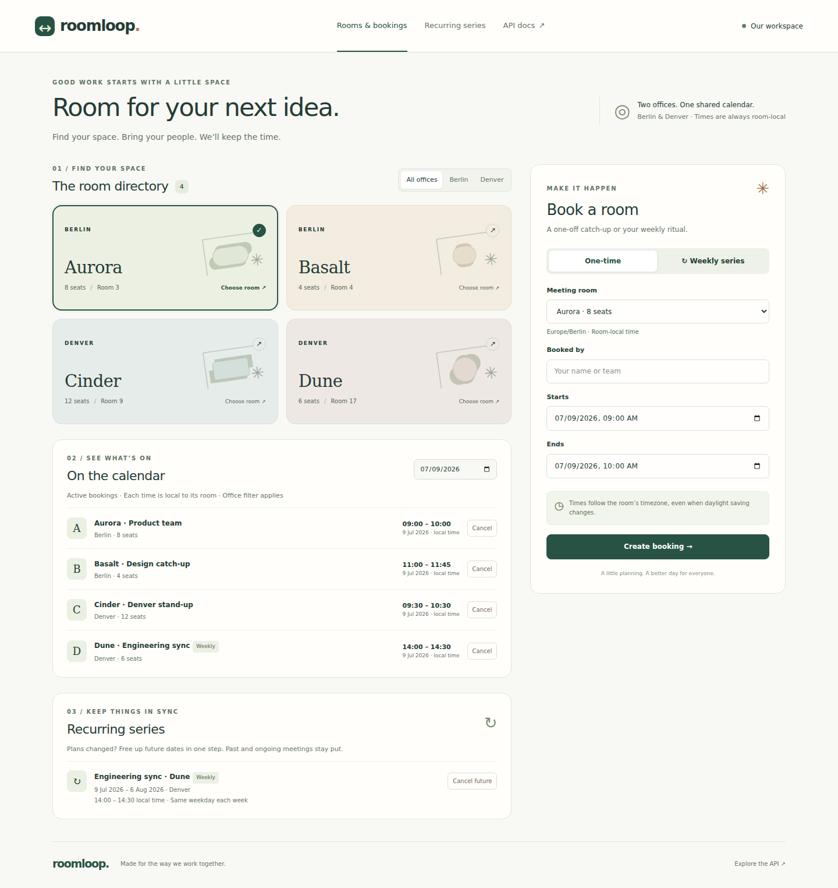

# RoomLoop

A small, durable meeting-room booking service for Berlin and Denver, with a
responsive dashboard.

**FastAPI · SQLite · Python zoneinfo · Jinja2 · plain CSS/JavaScript · pytest**

REST preserves the existing facilities dashboard's `GET /rooms` integration.
The new dashboard uses the same booking service and API; there is no separate
frontend server, build tool, ORM, or background scheduler.



[Mobile screenshot](docs/dashboard-mobile.png). Screenshots show synthetic test
data dated 9 July 2026; a new database starts with four rooms and no bookings.

## Run locally

Requires Python **3.11+**. From this repository's root on Linux/macOS:

```bash
python3 -m venv .venv
source .venv/bin/activate
python -m pip install -c constraints.txt -e '.[test]'
python -m roomloop.database var/roomloop.sqlite3
python -m uvicorn roomloop.app:app --host 127.0.0.1 --port 8000
```

On Windows, create the environment with `py -3 -m venv .venv` and activate it
with `.venv\Scripts\Activate.ps1`; the remaining `python` commands are the same.

Open **http://127.0.0.1:8000/** for the dashboard or **/docs** for interactive API
documentation. Initialization is also performed automatically at app startup.
It creates missing tables and seeds missing room IDs without overwriting records.
To choose another database, set `ROOMLOOP_DB` before starting Uvicorn. Its default
is `var/roomloop.sqlite3`, relative to the working directory. Database files are
ignored by Git. Keep them on a local disk, not a network filesystem.

`constraints.txt` records the dependencies used for verification; `pyproject.toml`
defines supported ranges. Browser testing is an optional development dependency.

## Test

```bash
python -m pytest -q
```

The default suite exercises the API and database, including separate-connection
concurrent writers, injected SQLite failures, DST, and an injected cancellation
clock. Browser cases are deselected by default.

```bash
python -m pip install -c constraints.txt -e '.[test,browser]'
python -m playwright install --with-deps chromium
python -m pytest -q -m browser
```

On Linux, `--with-deps` may require administrator access for browser libraries.
The browser tests start and stop their own loopback server and temporary database.
To regenerate the README screenshots on Linux/macOS:

```bash
ROOMLOOP_SCREENSHOTS=docs python -m pytest -q -m browser
```

The [original high-risk fixtures](tests/fixtures/high_risk.json) cover Berlin and
Denver DST transitions and conflicting weekly occurrences. Tests also verify
rollback, cancellation boundaries, persistence, API compatibility, and concurrent
requests using independent database connections.

Local verification on Python 3.14: **120 backend/API tests and 5 Chromium tests
passed** in the complete suite. All 11 documented API operations were also
exercised against a running Uvicorn server. The test client emits one upstream
Starlette deprecation warning about `httpx`. GitHub
Actions is configured to run backend tests on Python 3.11 and 3.14, followed by
Chromium tests. Python 3.11 and remote CI results have not yet been verified.

## Booking rules and deliberate interpretations

| Topic | Behavior |
| --- | --- |
| **R1 versus R2** | Literal all-or-nothing conflicts with skipping. Strict atomic series would reject any clash. This implementation instead commits the accepted subset atomically and returns skipped dates. **This departs from literal R1 and requires PM confirmation.** |
| Conflicts | Same room, active bookings, `[start, end)`: `new_start < existing_end AND existing_start < new_end`. Adjacent bookings are accepted. |
| Weekly rule | Every seven local calendar days from the seed weekday. Repeat-until is inclusive of occurrence **start dates**. One to 104 occurrences; no arbitrary RRULE strings. |
| Skipping | Skip any number of conflicts, extending R2 beyond two. All-conflict creation returns 409 and saves nothing, including no empty series. |
| Invalid series | Any invalid occurrence aborts the entire request, even if that date would conflict. Persistence or application failures roll back all accepted occurrences and series metadata. |
| Timezones | Aurora/Basalt: `Europe/Berlin`; Cinder/Dune: `America/Denver`. This mapping is an explicit seed assumption, not provided by the brief. |
| Legacy timestamps | Stored and returned `start`/`end` are naive local ISO strings, e.g. `2026-07-02T09:00:00`. Separate timezone snapshots and UTC epoch seconds support correct comparisons; UTC fields are not returned. |
| DST | Expand on the local calendar, never by fixed UTC weeks. Reject ambiguous autumn times and nonexistent spring times with 422, using UTC round trips for both endpoints. |
| Input | Positive interval, at most 24 local hours; overnight allowed. Years 0002–9998, no fractions or offsets. Input minutes are accepted and serialized with seconds. User: 1–100 trimmed characters. Historic bookings are allowed. |
| Preview | Validates the whole series and checks a consistent read snapshot; saves nothing. Creation always checks again under a write lock. |
| Series cancellation | Cancel active occurrences with `start_utc >= now`, capturing one aware UTC instant **after acquiring the lock**. Past and ongoing occurrences stay unchanged. Exactly-now starts are cancelled. |
| Individual cancellation | Explicitly cancels only that booking, even if it belongs to a series or has already started. Use the series endpoint to cancel future members together. |
| Repeated requests | Cancellation is idempotent in state; subsequent series calls report zero newly cancelled. Creation has no idempotency keys: active duplicate intervals conflict. Do not blindly retry an uncertain network result. |

The dashboard defaults to today's Berlin calendar date, displays every time in its
room's timezone, and labels the office. It never converts naive timestamps into the
viewer's browser timezone. Filter rooms by office, select a room, and create a
single booking or preview weekly dates. The result explicitly lists skipped dates
and conflicting booking references. Under **Recurring series**, **Cancel future**
opens a confirmation explaining which meetings will be preserved.

## API

| Method | Path | Result |
| --- | --- | --- |
| GET | `/rooms` | Original array of `{id, name, capacity}`; IDs are 3, 4, 9, 17 |
| GET | `/rooms/{id}` | Room details including timezone |
| POST | `/bookings` | 201, created booking |
| GET | `/bookings` | Booking array; filters below |
| GET | `/bookings/{id}` | One booking |
| POST | `/bookings/{id}/cancel` | 200, cancelled booking |
| POST | `/series/preview` | 200, `available`, `skipped`, `can_create`, `advisory` |
| POST | `/series` | 201, `series_id`, `created`, `skipped` |
| GET | `/series` | Series metadata array |
| GET | `/series/{id}` | Series metadata and all persisted occurrences |
| POST | `/series/{id}/cancel` | 200, `series_id`, `status`, newly `cancelled_count` |

List endpoints accept `limit` (default 100, maximum 500), `offset` (default 0),
and `timezone` (`Europe/Berlin` or `America/Denver`). Bookings additionally accept
`room_id`, `series_id`, `status` (`active`/`cancelled`), and `day` (`YYYY-MM-DD`, in
each room's local calendar, including overnight meetings crossing into that day).
Bookings sort by UTC start then ID; series sort by local seed start then ID.
The dashboard loads pages of 50. Pagination is offset-based, not a frozen snapshot.
Room IDs must be positive and offsets nonnegative; both must fit SQLite's signed
64-bit integer range. Out-of-range values return 422 before database access.

### Try it on an empty database

Create one booking:

```bash
curl -sS http://127.0.0.1:8000/bookings \
  -H 'Content-Type: application/json' \
  -d '{"room_id":3,"start":"2026-07-02T09:00:00","end":"2026-07-02T10:00:00","user":"Ada"}'
```

201 response (generated IDs are represented below as `<booking-id>`):

```json
{
  "id": "<booking-id>", "room_id": 3, "series_id": null, "user": "Ada",
  "start": "2026-07-02T09:00:00", "end": "2026-07-02T10:00:00",
  "timezone": "Europe/Berlin", "status": "active"
}
```

Preview a two-week series; July 2 will conflict with the booking above:

```bash
curl -sS http://127.0.0.1:8000/series/preview \
  -H 'Content-Type: application/json' \
  -d '{"room_id":3,"start":"2026-07-02T09:00:00","end":"2026-07-02T10:00:00","user":"Ada","rule":"weekly","repeat_until":"2026-07-09"}'
```

```json
{
  "available": [{"start":"2026-07-09T09:00:00","end":"2026-07-09T10:00:00","timezone":"Europe/Berlin"}],
  "skipped": [{"start":"2026-07-02T09:00:00","end":"2026-07-02T10:00:00","timezone":"Europe/Berlin","reason":"booking_conflict","conflicting_booking_ids":["<booking-id>"]}],
  "can_create": true,
  "advisory": true
}
```

Send that same body to `/series` to save the accepted dates:

```bash
curl -sS http://127.0.0.1:8000/series \
  -H 'Content-Type: application/json' \
  -d '{"room_id":3,"start":"2026-07-02T09:00:00","end":"2026-07-02T10:00:00","user":"Ada","rule":"weekly","repeat_until":"2026-07-09"}'
```

The 201 response contains `series_id`, one full booking in `created` (July 9,
with that `series_id`), and the same July 2 `skipped` detail. Replace placeholders
below with returned IDs:

```bash
curl -sS 'http://127.0.0.1:8000/bookings?room_id=3&day=2026-07-09'
curl -sS 'http://127.0.0.1:8000/series/<series-id>'
curl -sS -X POST 'http://127.0.0.1:8000/series/<series-id>/cancel'
curl -sS -X POST 'http://127.0.0.1:8000/bookings/<booking-id>/cancel'
```

Series cancellation returns `{"series_id":"<series-id>","status":"cancelled","cancelled_count":N}`.
`N` depends on the actual cancellation instant; these July examples may already
be past when you run them, in which case they are preserved and `N` is zero.

### Error contract

Errors use `{"error":{"code":"...","message":"...","details":...}}`.

| HTTP | Meaning |
| --- | --- |
| 404 | Missing room, booking, or series |
| 409 | Single overlap or all series occurrences conflict |
| 422 | Invalid request, duration, recurrence bounds, or ambiguous/nonexistent local time |
| 503 | SQLite writer timeout; includes `Retry-After: 1` |
| 500 | Database or unexpected application failure; transactional writes rolled back |

Validation `details` is a list of field/message objects. Conflict details contain
booking IDs or skipped occurrences; DST details contain local time and timezone.
Internal exception text stays in server logs. For example, repeating a single
active booking returns:

```json
{"error":{"code":"booking_conflict","message":"This room is already booked","details":{"conflicting_booking_ids":["<booking-id>"]}}}
```

## Integrity and limitations

`BEGIN IMMEDIATE` serializes writers before conflict checking and holds the lock
through commit. A preliminary availability check alone would race. SQLite provides
atomic writes; a partial index narrows active same-room overlap checks. Cancelled
records remain for inspection but do not block rooms. Separate connections and
separate service instances are tested against the same database file.

This is one small internal service, not a public booking platform. There is no
authentication/authorization, editing, notification delivery, calendar sync,
idempotency-key storage, room administration, or generic recurrence engine. Keep
the demo bound to loopback. A real shared deployment needs an access boundary,
backups, and a migration/operational plan. SQLite allows one writer at a time;
multi-host deployment would need a different storage design. Direct database
writes bypass application overlap checks and are not supported.

Series metadata stores the requested recurrence; only accepted occurrences are
persisted. Skipped explanations are returned at creation/preview, not stored as a
permanent audit log. A cancelled series may retain active historical bookings by
design. Timezone rule updates do not automatically rewrite already materialized
occurrences. The exact existing reporting schema beyond the brief's timestamp
contract still needs confirmation before migrating real data.

See [DECISIONS.md](DECISIONS.md) for design tradeoffs and open product questions.
